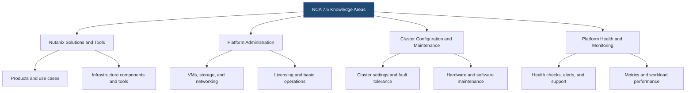
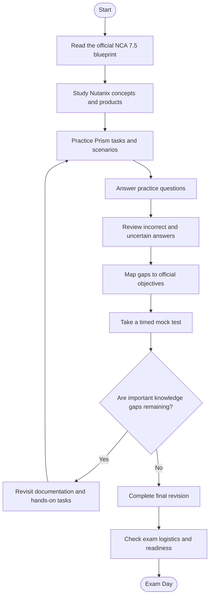
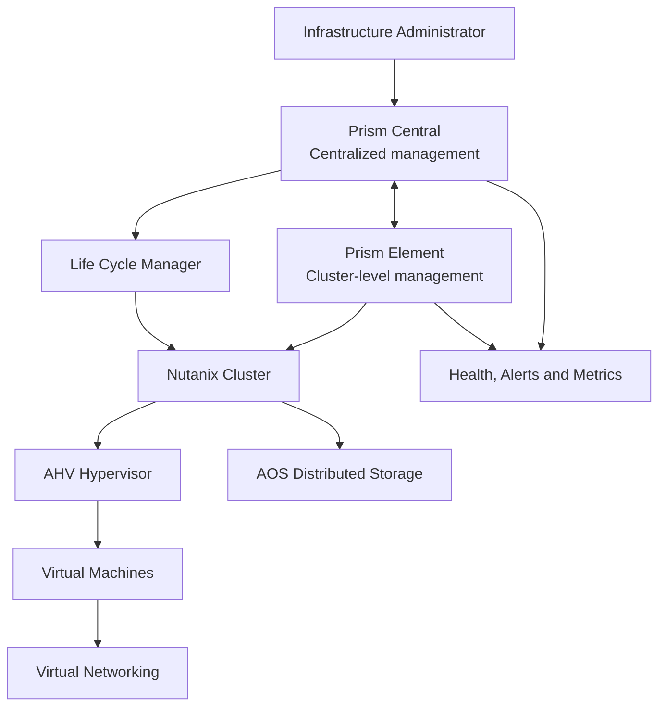
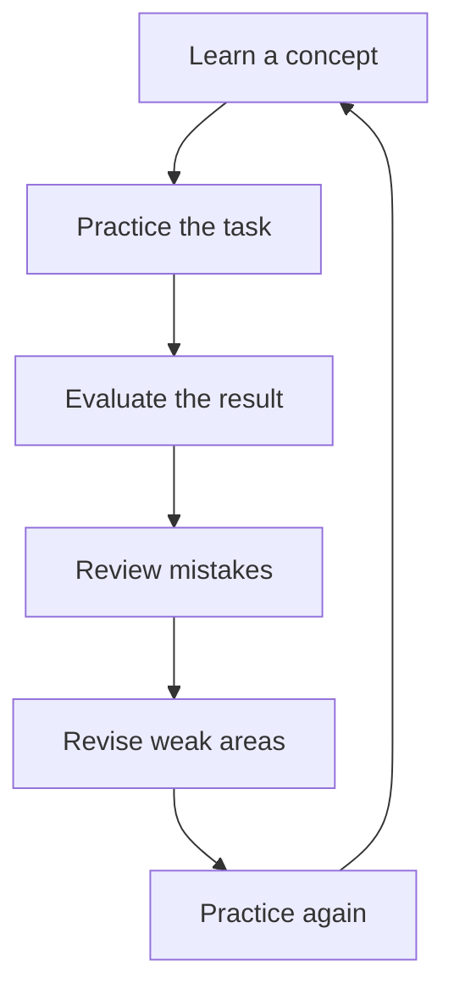

# Nutanix Certified Associate (NCA) 7.5 Study Guide

A practical, community-focused study guide for the **Nutanix Certified Associate (NCA) 7.5 certification exam**. This repository helps learners organize their preparation around Nutanix solutions, Prism administration, virtual machines, storage, networking, cluster maintenance, and infrastructure health monitoring.

Use this guide alongside the official Nutanix exam blueprint, product documentation, and hands-on practice. For additional independent study material, visit [CertsGate](https://certsgate.com/).

> **Version note:** This guide targets NCA 7.5. The official blueprint identifies AOS 7.5, AHV 11.0, and Prism Central pc.7.5 as the software versions covered. Always check the current official documentation before scheduling an exam.

---

## Table of Contents

- [About the NCA Certification](#about-the-nca-certification)
- [Who Should Prepare?](#who-should-prepare)
- [Exam Details](#exam-details)
- [Official Exam Objectives](#official-exam-objectives)
- [Conceptual Skills Map](#conceptual-skills-map)
- [Preparation Flowchart](#preparation-flowchart)
- [Nutanix Platform Architecture](#nutanix-platform-architecture)
- [Circular Study Cycle](#circular-study-cycle)
- [Step-by-Step Preparation Guide](#step-by-step-preparation-guide)
- [Four-Week Study Roadmap](#four-week-study-roadmap)
- [Hands-On Practice Projects](#hands-on-practice-projects)
- [NCA 7.5 Practice Questions](#nca-75-practice-questions)
- [Common Preparation Mistakes](#common-preparation-mistakes)
- [Readiness Checklist](#readiness-checklist)
- [Career Relevance](#career-relevance)
- [Frequently Asked Questions](#frequently-asked-questions)
- [Official and Additional Resources](#official-and-additional-resources)
- [About CertsGate](#about-certsgate)
  
---

## About the NCA Certification

The **Nutanix Certified Associate (NCA)** is a foundational certification for people learning to work with Nutanix infrastructure. The NCA 7.5 exam assesses knowledge of Nutanix products and their use cases, the ability to navigate the Prism user interface, and the ability to interpret information and perform basic operational tasks.

The certification is relevant to learners developing their understanding of hyperconverged infrastructure, virtualization, hybrid cloud operations, and centralized infrastructure management.

The exam covers more than recognizing product names. Candidates should understand why a Nutanix component is used, where a setting can be found in Prism, and how to interpret common health, alert, and performance information.

Start with the official [NCA certification page](https://www.nutanix.com/en_gb/support-services/training-certification/certifications/certification-details-nutanix-certified-associate-v6-10) and [NCA 7.5 Exam Blueprint Guide](https://www.nutanix.com/content/dam/nutanix/en/resources/datasheets/ds-ebg-nca.pdf).

## Who Should Prepare?

This NCA 7.5 study guide is suitable for:

- Junior infrastructure and systems administrators.
- Tier 1 support personnel.
- IT operations staff beginning to work with Nutanix.
- Students studying virtualization, cloud computing, or infrastructure management.
- IT professionals who want to understand Nutanix platform fundamentals before progressing to more advanced certifications.

The official blueprint describes a typical candidate as having approximately **3–6 months of general IT infrastructure and equivalent Nutanix experience**. This is a recommended background, not a guarantee of exam readiness or a mandatory substitute for checking current eligibility requirements.

## Exam Details

The following details are drawn from the official NCA 7.5 blueprint.

| Exam information | Officially documented detail |
|---|---|
| Certification | Nutanix Certified Associate (NCA) |
| Exam version | NCA 7.5 |
| Question format | Multiple-choice and multiple-response |
| Number of questions | 50 |
| Time limit | 90 minutes |
| Passing score | 3000 on a scaled score range of 1000–6000 |
| Published price | US$100 per attempt |
| Languages | English and Japanese |
| Delivery | Remote proctoring or in-person at select test centers |
| Certification validity | Three years |
| Software versions listed | AOS 7.5, AHV 11.0, Prism Central pc.7.5 |

**Important:** Exam policies, pricing, and availability can change. Confirm the details on the [official blueprint](https://www.nutanix.com/content/dam/nutanix/en/resources/datasheets/ds-ebg-nca.pdf) before registering. The passing score is scaled; it should not be interpreted as a simple percentage of questions answered correctly.

---

## Official Exam Objectives

The NCA 7.5 blueprint groups its objectives into four sections. Use these official sections as the foundation of your preparation.

### Section 1 — Recognize Nutanix Solutions and Tools

Study the purpose, features, and use cases of Nutanix solutions and supporting tools.

Key topics include:

- Nutanix Cloud Infrastructure (NCI) components and deployment scenarios.
- Supported hypervisors and core infrastructure concepts.
- Nutanix Unified Storage, Nutanix Database Service, Nutanix Cloud Manager, Nutanix Kubernetes Platform, Nutanix Enterprise AI, and end-user computing solutions.
- Nutanix Move, Nutanix Guest Tools (NGT), Foundation, Witness, Self-Service Restore, X-Ray, and Collector.
- Replication factor, cluster options, lifecycle management, and disaster recovery concepts.

**Study approach:** Learn what each solution or tool does, what problem it addresses, and how to distinguish it from related products.

### Section 2 — Describe Nutanix Platform Administration

This section focuses on basic operational tasks in the Nutanix environment.

Key topics include:

- Creating, updating, configuring, and managing virtual machines.
- VM storage, network attributes, categories, templates, and snapshots.
- AHV networking, subnets, virtual switches, and physical network connectivity.
- Storage types, redundancy, replication factors, and storage optimization.
- License states, assignment, reclamation, expiration, and use-case selection.

**Study approach:** Practice locating these features in Prism and explaining what each setting changes.

### Section 3 — Describe Cluster Configuration and Maintenance

Learn the settings and maintenance operations used to keep a Nutanix cluster correctly configured.

Key topics include:

- DNS, SMTP, SNMP, NTP, and Prism Central settings.
- Fault tolerance, security options, and cluster configuration.
- Hardware maintenance mode, node expansion, and out-of-band management.
- Life Cycle Manager (LCM), inventory checks, software upgrades, firmware updates, and compatibility.
- Connected-site versus dark-site maintenance workflows.

**Study approach:** Understand the purpose and prerequisites of a maintenance task before learning its sequence.

### Section 4 — Understand Platform Health and Monitoring

This section emphasizes interpreting platform health and performance information.

Key topics include:

- Cluster health checks, Nutanix Cluster Check (NCC), and log collection.
- Alerts, events, severity levels, Pulse, and custom alert policies.
- Support cases, documentation, and Insights.
- Prism metrics and charts.
- CPU contention, CPU ready time, memory constraints, and I/O latency.

**Study approach:** Practice moving from an observation to a reasonable next step. For example, distinguish a CPU contention symptom from a storage-latency problem before proposing a response.

For the full objective descriptions and associated references, consult the [official exam blueprint](https://www.nutanix.com/content/dam/nutanix/en/resources/datasheets/ds-ebg-nca.pdf).

---

## Conceptual Skills Map

**This is an independent study overview, not an official exam-weighting chart.** The official blueprint describes four objective sections, but this guide does not assign percentages that have not been verified from an official published weighting table.

Use this map to organize notes, but always refer to the official objectives when deciding which topics to study.

---

## Preparation Flowchart

Certification preparation works best as a repeatable process. Reviewing the objectives helps you choose the right material, while practice and mistake analysis reveal where further study is needed.

The purpose of this process is not to complete a fixed number of questions. It is to build reliable understanding of the skills the exam measures.

## Nutanix Platform Architecture

The following is a **conceptual learning diagram**, not a complete or official deployment design. It shows how an administrator might interact with the core Nutanix infrastructure components while learning NCA topics.

### Components to understand

| Component | What to learn |
|---|---|
| Prism Central | Centralized management, monitoring, and administration |
| Prism Element | Cluster-level management and operational visibility |
| AHV | The hypervisor used to run virtual machines in an AHV environment |
| AOS | Distributed storage and data services within the Nutanix platform |
| Virtual machines | Compute resources, virtual disks, network interfaces, snapshots, and basic configuration |
| Virtual networking | Subnets, virtual switches, and connectivity between workloads |
| Life Cycle Manager | Inventory and supported software or firmware maintenance workflows |
| Health and metrics | Cluster status, alerts, events, and workload performance indicators |

Learn the relationships between components rather than memorizing a diagram in isolation.

---

## Circular Study Cycle

The NCA preparation cycle should continue until you can explain the concepts and apply them to realistic administrative scenarios.

For example, after studying VM snapshots, practice describing their purpose, where snapshot operations are managed, and how they differ from other recovery or data-protection approaches. Then use questions to identify gaps and revisit the relevant documentation.

---

## Step-by-Step Preparation Guide

### 1. Start with the official blueprint

Read the [NCA 7.5 Exam Blueprint Guide](https://www.nutanix.com/content/dam/nutanix/en/resources/datasheets/ds-ebg-nca.pdf) before choosing study materials.

Turn each objective into a checklist. Mark topics as:

- **Not started:** You have not studied the topic.
- **Learning:** You understand some of the concepts but need further review.
- **Practiced:** You have worked through a relevant task or scenario.
- **Ready to explain:** You can describe the concept and reason through an example without relying on notes.

### 2. Build a foundation in Nutanix products

Learn the purpose of NCI, AOS, AHV, Prism Central, and Prism Element. Then explore the use cases of the additional Nutanix solutions and tools listed in the blueprint.

A useful technique is to create a comparison table with three columns: product or tool, its main purpose, and an example of when an administrator might use it.

### 3. Learn by navigating Prism

Where you have access to a suitable environment, practice locating VM configuration, networking, storage, cluster health, alerts, and maintenance features.

If a live environment is unavailable, use official documentation, product demonstrations, and the Nutanix Test Drive where available. Be clear about which tasks you have actually performed and which you have only reviewed.

### 4. Study operations and maintenance

Review how to interpret cluster settings, fault tolerance, licensing, and maintenance workflows. Focus on why prerequisites matter and what should be checked before an administrator changes a configuration.

Do not treat upgrades, node maintenance, or licensing changes as tasks to perform on a production system merely for practice. Use an authorized lab or follow the relevant documented procedure.

### 5. Practice monitoring and troubleshooting

Use example scenarios to connect symptoms to evidence:

- A VM appears slow: which CPU, memory, and I/O indicators should be examined?
- An alert appears: how do severity, impact, and supporting details influence the next action?
- A maintenance task is planned: what compatibility, health, and prerequisite checks are relevant?
- A cluster reports a health issue: what information should be collected before escalating?

### 6. Use practice questions to expose gaps

Supplementary resources, including [CertsGate](https://certsgate.com/), can help you test your understanding. Use practice questions after studying the underlying concepts rather than as a replacement for the official blueprint and product documentation.

For every incorrect or guessed answer:

1. Explain why the selected answer was wrong.
2. Identify the principle that supports the correct answer.
3. Link the mistake to an official exam objective.
4. Revisit the relevant documentation.
5. Try a different question or practical scenario.

### 7. Complete a readiness review

Before booking or sitting the exam, review all four official sections and confirm that you can explain the core concepts in your own words. A strong practice score is useful evidence, but it is not a guarantee of an exam result.

---

## Four-Week Study Roadmap

This is a suggested schedule, not an official Nutanix requirement. Adjust it to your prior experience, access to a lab, and time available.

| Week | Focus | Suggested activities |
|---|---|---|
| 1 | Solutions and tools | Read the blueprint, map Nutanix products to use cases, study core components |
| 2 | Platform administration | Review VM tasks, virtual networking, storage, and licensing |
| 3 | Cluster configuration and monitoring | Study fault tolerance, maintenance, LCM, alerts, health checks, and performance metrics |
| 4 | Assessment and revision | Answer practice questions, review mistakes, revisit documentation, and take a timed mock test |

A simple weekly routine is to spend one session learning concepts, one session working through documentation or hands-on tasks, and one session reviewing questions and mistakes. Revisit difficult topics throughout the week instead of leaving every weak area until the final day.

---

## Hands-On Practice Projects

Use these exercises to make abstract concepts easier to understand. They are independent learning activities, not official exam labs.

### Project 1: Create a Nutanix component reference

Prepare a one-page reference describing AOS, AHV, Prism Central, Prism Element, and Life Cycle Manager.

For each component, document its role, the information it provides, and one relevant administrative use case.

### Project 2: Build a VM administration checklist

Using official documentation or an authorized lab, outline the steps and considerations involved in:

- Creating or configuring a VM.
- Reviewing CPU, memory, storage, and network attributes.
- Assigning a category where appropriate.
- Creating and managing a snapshot.
- Verifying the resulting configuration.

Record prerequisites and potential risks instead of simply listing clicks.

### Project 3: Map a virtual networking scenario

Create a diagram showing a VM, its virtual network, the relevant virtual switch, and the physical network connection.

Explain how subnet configuration and connectivity affect workload communication. Use official AHV networking documentation to verify the terms and relationships.

### Project 4: Develop a cluster maintenance checklist

Draft a pre-maintenance checklist covering cluster health, compatibility, supported update paths, and relevant LCM inventory checks.

Distinguish preparation and validation from the actual maintenance operation. Follow current official procedures for any real environment.

### Project 5: Investigate a performance scenario

Create a fictional scenario in which a VM experiences slow performance. List the observations you would collect from Prism and explain how CPU contention, CPU ready time, memory constraints, and I/O latency might affect the investigation.

Do not assume that one metric alone proves the root cause.

---

## NCA 7.5 Practice Questions

These are **original study questions written for this repository**. They are not official Nutanix exam questions and are not intended to reproduce the live exam.

### Question 1

Which Nutanix interface is primarily associated with centralized management across a Nutanix environment?

A. Prism Central  
B. A VM guest operating system  
C. A physical network switch  
D. A storage device console unrelated to Nutanix

**Answer: A. Prism Central**

**Explanation:** Prism Central provides centralized management capabilities. Candidates should also understand the role of Prism Element in cluster-level administration.

### Question 2

An administrator wants to understand the purpose of a virtual machine snapshot. Which statement is the most appropriate?

A. It is a substitute for every form of backup and disaster recovery.  
B. It captures a point-in-time state of a VM's virtual disks according to the supported snapshot behavior.  
C. It automatically resolves all performance issues.  
D. It replaces cluster health monitoring.

**Answer: B.**

**Explanation:** Understand what a snapshot captures and its limitations. Do not treat snapshots as a universal substitute for an appropriate backup or recovery strategy.

### Question 3

Which tool is associated with inventory and supported software or firmware lifecycle operations in a Nutanix environment?

A. Life Cycle Manager (LCM)  
B. A guest text editor  
C. A spreadsheet application  
D. A browser bookmark manager

**Answer: A. Life Cycle Manager (LCM)**

**Explanation:** The blueprint includes LCM inventory and software maintenance tasks. Candidates should understand the applicable prerequisites and compatibility considerations.

### Question 4

A VM is reported to have poor performance. What is the best initial approach?

A. Assume the storage is always responsible.  
B. Change several cluster settings immediately.  
C. Review relevant Prism metrics and alerts, including CPU, memory, and I/O indicators.  
D. Disable monitoring.

**Answer: C.**

**Explanation:** Use available evidence to narrow down potential causes. Metrics should be interpreted in context rather than treated as isolated proof.

### Question 5

Which topic is directly included in the NCA 7.5 platform administration objectives?

A. Virtual machine tasks  
B. Writing a new hypervisor from scratch  
C. Building a custom operating system kernel  
D. Developing a new programming language

**Answer: A. Virtual machine tasks**

**Explanation:** The official blueprint includes deploying, updating, and configuring VMs, along with storage, network attributes, categories, and snapshots.

### Question 6

Why should an administrator review compatibility information before a software or firmware upgrade?

A. To eliminate the need for all health checks.  
B. To verify that the planned maintenance aligns with supported versions and requirements.  
C. To make every cluster configuration identical.  
D. To avoid reading release documentation.

**Answer: B.**

**Explanation:** Compatibility and prerequisites are important parts of responsible maintenance planning.

### Question 7

What should an administrator do when an alert appears in Prism?

A. Ignore it if the VM is still running.  
B. Immediately restart every VM in the cluster.  
C. Review the alert details, severity, potential impact, and supporting information.  
D. Delete the alert without investigation.

**Answer: C.**

**Explanation:** The blueprint includes interpreting alerts and events, determining impact, and planning an appropriate resolution.

### Question 8

What is the most useful way to use an incorrect practice-question answer?

A. Memorize the correct letter and move on.  
B. Identify the underlying concept, map it to an exam objective, and revisit the relevant material.  
C. Avoid that objective in future study sessions.  
D. Assume the question was necessarily defective.

**Answer: B.**

**Explanation:** Mistake analysis helps turn practice into learning. Understanding why an answer is correct is more useful than memorizing an answer pattern.

---

## Common Preparation Mistakes

### Memorizing product names without understanding use cases

Learn what each Nutanix solution does, when it is useful, and how it differs from related components.

### Ignoring Prism navigation

The exam measures basic operational knowledge as well as product awareness. Review how administrators locate information and perform supported tasks in Prism.

### Skipping networking and storage fundamentals

VM administration, virtual networking, storage operations, and redundancy are interconnected. Study how they affect a workload rather than treating each topic as an isolated definition.

### Treating practice scores as proof of readiness

Practice tests can reveal knowledge gaps, but they do not guarantee the same performance on the official exam. Review the reasoning behind every uncertain answer.

### Neglecting maintenance and monitoring

Cluster configuration, LCM, health checks, alerts, support functions, and performance metrics are all part of the published objectives.

### Using outdated study material

NCA 7.5 has a specific blueprint and software-version context. Confirm that third-party material aligns with the current exam rather than an older NCA version.

---

## Readiness Checklist

Use this checklist during your final review.

- [ ] I have read the current official NCA 7.5 blueprint.
- [ ] I can explain the purpose of the core Nutanix products and tools.
- [ ] I understand the relationship between Prism Central and Prism Element.
- [ ] I can describe common VM configuration and snapshot tasks.
- [ ] I understand basic AHV virtual networking concepts.
- [ ] I can explain storage types, redundancy, and replication-factor concepts.
- [ ] I understand license states and common licensing operations.
- [ ] I can describe cluster configuration and maintenance considerations.
- [ ] I understand LCM inventory, compatibility, and upgrade planning.
- [ ] I can interpret basic health checks, alerts, and events.
- [ ] I can explain how CPU, memory, and I/O metrics help investigate performance.
- [ ] I have reviewed incorrect and uncertain practice-question answers.
- [ ] I have confirmed the latest exam policies and registration details.

If several items remain unchecked, use them to plan another focused revision cycle.

---

## Career Relevance

NCA is a foundational credential for learners developing Nutanix infrastructure knowledge. The skills covered in its blueprint relate to entry-level infrastructure operations, virtualization support, systems administration, and basic platform monitoring.

Preparing for NCA can also establish useful groundwork for more advanced Nutanix learning. Career outcomes depend on practical experience, the needs of an employer, and broader technical skills; certification alone does not guarantee a role or promotion.

## Frequently Asked Questions

### What is the NCA 7.5 certification?

The Nutanix Certified Associate (NCA) 7.5 is a foundational certification that assesses Nutanix product awareness, Prism navigation, and basic operational knowledge.

### How many questions are on the NCA 7.5 exam?

The official blueprint lists 50 multiple-choice and multiple-response questions, with a 90-minute time limit. Confirm current details before registering.

### What is the NCA 7.5 passing score?

The official blueprint lists a scaled passing score of 3000 on a scale from 1000 to 6000. This is not a direct percentage of correct answers.

### Which topics should I prioritize?

Cover all four official sections: Nutanix solutions and tools, platform administration, cluster configuration and maintenance, and platform health and monitoring. Use the official blueprint to guide your priorities rather than assuming unpublished domain percentages.

### Is hands-on experience necessary?

The blueprint recommends relevant Nutanix and IT infrastructure knowledge. Hands-on exposure is valuable because it helps connect product concepts to Prism workflows, operational tasks, and monitoring information.

### Are third-party practice questions sufficient?

They should be treated as supplementary material. Use official objectives and product documentation as your foundation, and investigate explanations rather than relying on memorized answers.

### Where can I find official NCA study resources?

Begin with the [official exam blueprint](https://www.nutanix.com/content/dam/nutanix/en/resources/datasheets/ds-ebg-nca.pdf), the [Nutanix Hybrid Cloud Fundamentals course](https://www.nutanix.com/support-services/training-certification/training), and the [Nutanix University certification pages](https://www.nutanix.com/support-services/training-certification/certifications).

---

## Official and Additional Learning Resources

Use official sources for exam requirements and technical accuracy.

| Resource | How to use it |
|---|---|
| [NCA 7.5 Exam Blueprint Guide](https://www.nutanix.com/content/dam/nutanix/en/resources/datasheets/ds-ebg-nca.pdf) | Primary reference for exam details, objectives, recommended preparation, and technical references |
| [Nutanix NCA certification page](https://www.nutanix.com/en_gb/support-services/training-certification/certifications/certification-details-nutanix-certified-associate-v6-10) | Certification overview and links to Nutanix resources |
| [Nutanix University training](https://www.nutanix.com/support-services/training-certification/training) | Explore official courses and learning options |
| [Nutanix Hybrid Cloud Fundamentals (NHCF)](https://www.nutanix.com/support-services/training-certification/training) | Recommended foundational learning for new Nutanix learners; search the training catalog for the current course listing |
| [Nutanix documentation](https://portal.nutanix.com/page/documents/list) | Product documentation and technical procedures; some resources may require portal access |
| [Nutanix Community](https://next.nutanix.com/) | Discussions, announcements, and shared learning from the Nutanix community |
| [Nutanix Test Drive](https://www.nutanix.com/test-drive) | Explore available product demonstrations and guided experiences |
| [CertsGate](https://certsgate.com/) | Independent supplementary exam-preparation materials and practice resources |

Official documentation should take priority whenever a third-party explanation differs from the current Nutanix guidance.

---

## About CertsGate

[CertsGate](https://certsgate.com/) provides independent IT certification preparation resources that learners may use alongside official documentation and practical exercises.

For NCA 7.5 preparation, supplementary study guides and practice questions can help you revisit key concepts, check your understanding, and identify topics that need further attention.

Use third-party materials as a learning aid, not as a replacement for the official Nutanix exam blueprint. Review explanations, verify technical details against vendor documentation, and avoid materials that claim to guarantee a passing result or provide verified access to live exam questions without authorization.

CertsGate is referenced here as an independent resource; this repository does not claim an official partnership or endorsement by Nutanix.
